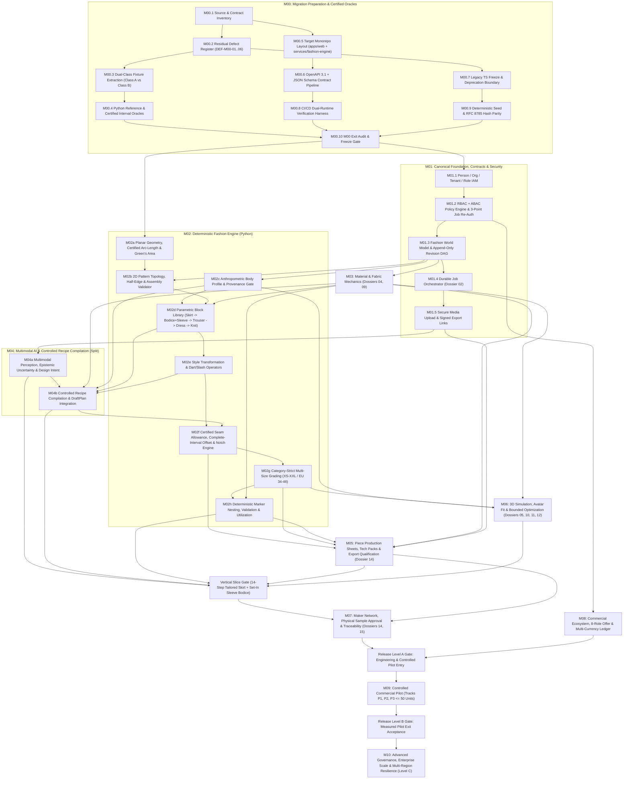

# 05 — WORKLOAD DEPENDENCY GRAPH (`R2.1`)

**Document ID:** `PATRONER-BP-R2.1-05`  
**Status:** Authoritative Workload Sequencing, `M04a`/`M04b` Split, `M02h` Integration & Critical-Path Specification  
**Governing Baseline:** `Patroner_Living_Project_Monograph_v5.16_Consolidated_Master.pdf` (`Ch. 14`, `Ch. 15`, `App. F`)

---

## 1. Governing Sequencing Principles (`R2.1` Corrected)

1. **Pre-Migration Defect Closure First (`M00`):** Residual mathematical, geometric, quantity, and tenant-isolation defects (`DEF-M00-01` through `DEF-M00-06`) must be cataloged as Class A Legacy Reference vs. Class B Normative fixtures (`M00.3` / `M00.4`) before any Python port in `M02` or `M05` begins.
2. **Security and Domain Authority Before Computation (`M01`):** No production computational engine, AI workflow, or manufacturing export may run outside the `M01` tenant-isolated, RBAC+ABAC-authorized, append-only revision graph (`REQ-SEC-01`, `REQ-SEC-02`, `REQ-WM-02`).
3. **Separation of `M04a` (Perception & Intent) from `M04b` (Recipe Compilation) (`Correction 01`):**
   - **`M04a` (Multimodal Perception & Design Intent)** depends **only** on `M01` (`M01.3` World Model & `M01.4`/`M01.5` Secure Media Intake). It executes *before* deterministic drafting (`M02d`/`M02e`) and produces a human-confirmed `GarmentIntentSpecification`.
   - **`M04b` (Controlled Recipe Compilation & Engine Integration)** depends on `M04a`, `M02c` (Body Measurements), `M02d` (Parametric Blocks), `M02e` (Style Operators), and `M03` (Material Mechanics) to compile the approved intent into a typed `GarmentRecipe` / `RecipeOperatorAST` / `DraftPlan`.
4. **Integration of `M02h` (Marker Nesting) into the Vertical Slice & `M05` (`Correction 02`):**
   - `M02h` (Deterministic Marker Nesting, Validation & Utilization Reporting) depends on `M02g` (Validated Multi-Size Grading) and `M03` (Material & Fabric-Width Constraints), and is a **hard prerequisite** for `M05` (Piece Production Sheets, BOM Fabric Consumption & Tech Packs) and the **Vertical Slice Gate (`Step 12`)**.
5. **Non-Circular Release Governance Between `M09` and `M10` (`Correction 03`):**
   - `M09` (Controlled Commercial Pilot) enters at **Release Level A (Engineering & Controlled Pilot Entry)** and exits at **Release Level B (Measured Pilot Acceptance)**.
   - `M10` (Enterprise & Institutional Scale) is strictly downstream of `M09` (`Level B`) and governs **Release Level C**. Zero `M10`-only institutional capabilities block `M09` entry.

---

## 2. Master Dependency Graph (Mermaid — `R2.1` Corrected)

---

## 3. Workload Prerequisite & Concurrency Matrix (`R2.1`)

| Workload / Sub-Workload | Hard Prerequisites | Parallelizable With | Unlocks | Primary Acceptance Gates | Release Governance Stage |
| :--- | :--- | :--- | :--- | :--- | :---: |
| **`M00` Migration Prep** | None (Starts from commit `e9d99cb4`) | None — foundation freeze | `M01`, `M02a` | `AC-01`, `AC-02`, `AC-03`, `AC-04` | Pre-Level A |
| **`M01` Foundation & Security** | `M00.10` | `M02a` (pure geometry kernel) | `M02b`–`M02h`, `M03`, `M04a`, `M05`, `M08` | `AC-01`, `AC-02`, `AC-04`, `AC-11` | Level A |
| **`M04a` Multimodal Perception & Intent** | `M01.3`, `M01.5` | `M02a`–`M02e`, `M03` | `M04b`, `Vertical Slice (Steps 02–03)` | `AC-01`, `AC-02`, `AC-04`, `AC-11` | Level A |
| **`M02a` Geometry Kernel** | `M00.4`, `M00.10` | `M01`, `M02c`, `M04a` | `M02b`, `M02f`, `M05` | `AC-01`, `AC-02`, `AC-03` | Level A |
| **`M02b` Pattern Topology & Assembly** | `M01.3`, `M02a` | `M02c`, `M03`, `M04a` | `M02d`, `M02e`, `M02f` | `AC-02`, `AC-03`, `AC-05` | Level A |
| **`M02c` Anthropometric Body Profile** | `M01.3` | `M02a`, `M02b`, `M03`, `M04a` | `M02d`, `M04b`, `M06` | `AC-02`, `AC-05` | Level A |
| **`M03` Material & Fabric Mechanics** | `M01.3` | `M02a`–`M02c`, `M04a` | `M02d`, `M04b`, `M02h`, `M05`, `M06` | `AC-04`, `AC-07` | Level A |
| **`M02d` Parametric Block Library** | `M02b`, `M02c`, `M03` (ease policies) | `M04a` | `M02e`, `M04b`, `M02f`, `M02g` | `AC-03`, `AC-05` | Level A |
| **`M02e` Style Transformation Operators** | `M02d` | `M04a` | `M04b`, `M02f` | `AC-03`, `AC-05` | Level A |
| **`M04b` Controlled Recipe Compilation** | `M04a`, `M02c`, `M02d`, `M02e`, `M03` | `M06.1`–`M06.3` (solver prep) | `M02f` (compiled `DraftPlan` execution), `Vertical Slice (Step 06)` | `AC-02`, `AC-04`, `AC-05` | Level A |
| **`M02f` Certified Seam, Offset & Notch** | `M02a`, `M02b`, `M02d`, `M02e`, `M04b` | `M06.1`–`M06.3` | `M02g`, `M05` | `AC-03`, `AC-05`, `AC-10` | Level A |
| **`M02g` Multi-Size Grading** | `M02f` | `M06` (base-size drape) | `M02h`, `M05`, `M06` (graded verification) | `AC-03`, `AC-06` | Level A |
| **`M02h` Marker Nesting & Validation** | `M02g`, `M03` (fabric width/nap/shrinkage) | `M06` | `M05` (BOM consumption & marker artifacts), `Vertical Slice (Step 12)` | `AC-03`, `AC-05`, `AC-10` | Level A |
| **`M05` Production Sheets & Tech Packs** | `M01.5`, `M02f`, `M02g`, `M02h`, `M03` | `M06`, `M08` | `Vertical Slice (Step 12–14)`, `M07` | `AC-03`, `AC-06`, `AC-10`, `AC-11` | Level A |
| **`M06` 3D Simulation, Fit & Optimization** | `M02c`, `M02g`, `M03` | `M02h`, `M05`, `M08` | `Vertical Slice (Steps 08–10)`, `M07` | `AC-07`, `AC-08`, `AC-09` | Level A |
| **`M07` Maker Network & Traceability** | `M05`, `Vertical Slice` | `M08` | `Release Level A Gate` → `M09` | `AC-09`, `AC-10`, `AC-11` | Level A |
| **`M08` Commerce & Multi-Currency Ledger** | `M01.2`, `M01.3` | `M02`–`M07` | `Release Level A Gate` → `M09` | `AC-04`, `AC-11`, `AC-12` | Level A |
| **`M09` Controlled Commercial Pilot** | `Release Level A Gate` (`Vertical Slice` + `M07` + `M08`) | None — live pilot execution | `Release Level B Gate` → `M10` | `AC-01`–`AC-12` (Level B Real Evidence) | Enters Level A / Exits Level B |
| **`M10` Advanced Governance & Scale** | `Release Level B Gate` (`M09` Exit) | Post-pilot track expansion | Enterprise Multi-Brand Operations (`Level C`) | `AC-04`, `AC-11`, `AC-12` (Level C) | Level C |

---

## 4. Corrected Critical Path Analysis (`R2.1`)

### 4.1 Critical Path 1 — To First End-to-End Vertical Slice (`plan/08_VERTICAL_SLICE_DEFINITION.md`)
$$\texttt{M00} \longrightarrow \texttt{M01} \longrightarrow (\texttt{M04a} \parallel \texttt{M02a} \to \texttt{M02b} \parallel \texttt{M02c} \parallel \texttt{M03}) \longrightarrow \texttt{M02d (Skirt + Bodice)} \longrightarrow \texttt{M02e} \longrightarrow \texttt{M04b} \longrightarrow \texttt{M02f} \longrightarrow (\texttt{M06} \parallel [\texttt{M02g} \to \texttt{M02h} \to \texttt{M05}]) \longrightarrow \texttt{Vertical Slice Gate}$$

- **Key R2.1 Corrections on Critical Path 1:**
  1. **`M04a` Is Unblocked Early (`Correction 01`):** `M04a` runs in parallel with `M02a`–`M02e` immediately after `M01`, so reference sketch/image intake and human disambiguation (`Steps 02–03`) are ready before recipe compilation (`M04b`, `Step 06`).
  2. **`M02h` Is Explicitly on the Critical Path to `M05` & `Vertical Slice` (`Correction 02`):** `M02g` (Validated Multi-Size Grading) + `M03` (Fabric Width/Grain/Nap Rules) feed `M02h` (Deterministic Marker Nesting & Validation), which feeds `M05` (Piece Production Sheets, BOM Fabric Consumption & Tech Packs) at `Step 12`.

### 4.2 Critical Path 2 — To Controlled Commercial Pilot (`M09` — `Level A` to `Level B`)
$$\texttt{Vertical Slice Gate} \longrightarrow \texttt{M07 (Maker Qualification + Physical Sample Approval + Traceability)} + \texttt{M08 (8-Role Offer + Multi-Currency Double-Entry Ledger)} \longrightarrow \texttt{Release Level A Gate} \longrightarrow \texttt{M09 Commercial Pilot} \longrightarrow \texttt{Release Level B Gate} \longrightarrow \texttt{M10 (Level C)}$$

- **Key R2.1 Correction on Critical Path 2 (`Correction 03`):**
  - `M09` entry depends on **Release Level A** (`Vertical Slice` + `M07` + `M08`), **never** on `M10`.
  - `M10` (`Level C` Enterprise Scale, Multi-Region DR, BYOK KMS, Automated Self-Serve/Celebrity Waterfalls) depends strictly on `M09` passing **Release Level B**.
