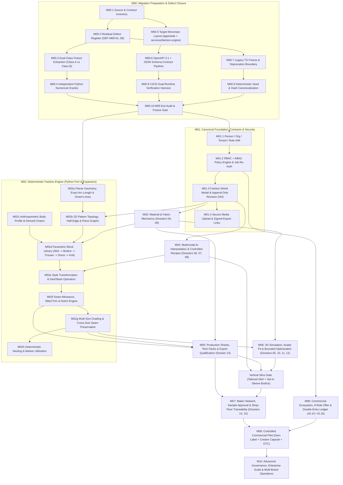

# 05 — WORKLOAD DEPENDENCY GRAPH

**Document ID:** `PATRONER-BP-R2-05`  
**Status:** Authoritative Workload Sequencing & Critical-Path Specification  
**Governing Baseline:** `Patroner_Living_Project_Monograph_v5.16_Consolidated_Master.pdf` (`Ch. 15` & `App. F`)

---

## 1. Governing Sequencing Principles

1. **Pre-Migration Defect Closure First (`M00`):** Residual mathematical, geometric, quantity, and tenant-isolation defects (`DEF-M00-01` through `DEF-M00-06`) must be cataloged as Class A Legacy Reference vs. Class B Normative fixtures (`M00.3` / `M00.4`) before any Python port in `M02` or `M05` begins.
2. **Security and Domain Authority Before Computation (`M01`):** No production computational engine, AI workflow, or manufacturing export may run outside the `M01` tenant-isolated, RBAC+ABAC-authorized, append-only revision graph (`REQ-SEC-01`, `REQ-SEC-02`, `REQ-WM-02`).
3. **Sub-Workload Decomposition of the Deterministic Engine (`M02a`–`M02h`):** `M02` is decomposed into eight explicit sub-workloads (`M02a` through `M02h`) so that parallelizable geometry/topology work (`M02a`–`M02c`) does not block garment-family block rollout (`M02d`: `skirt-block-v1` → `bodice-sleeve-v1` → `trouser-block-v1` → `dress-foundation-v1` → `knit-tshirt-v1`).
4. **Physical & Material Calibration Before Optimization (`M03` → `M06`):** `M06` bounded pattern optimization (`Dossier 05` / `Dossier 12`) cannot promote revisions until `M03` material properties (`Dossier 04` / `Dossier 09`) and `M06` physical fit validation (`Dossier 06` / `Dossier 10`) pass their respective credibility gates (`AC-07`, `AC-08`, `AC-09`).
5. **Hard Gate on `isProductionReady` (`M05` + `M07` → `M09`):** `isProductionReady` remains hardcoded to `false` until `M05` (`AC-10` tech-pack & cut-file qualification) and `M07` (`AC-10` physical sample approval & shop-floor traceability) both pass (`REQ-MFG-01`).

---

## 2. Master Dependency Graph (Mermaid)

---

## 3. Workload Dependency & Concurrency Matrix

| Workload | Hard Prerequisites | Parallelizable With | Unlocks | Primary Acceptance Gates |
| :--- | :--- | :--- | :--- | :--- |
| **`M00` Migration Prep** | None (Starts from commit `e9d99cb4`) | None — foundation freeze | `M01`, `M02a` | `AC-01`, `AC-02`, `AC-03`, `AC-04` |
| **`M01` Foundation & Security** | `M00.10` | `M02a` (pure math kernel development) | `M02b`–`M02h`, `M03`, `M04`, `M05`, `M08` | `AC-01`, `AC-02`, `AC-04`, `AC-11` |
| **`M02a` Geometry Kernel** | `M00.4`, `M00.10` | `M01`, `M02c` | `M02b`, `M02f`, `M05` | `AC-01`, `AC-02`, `AC-03` |
| **`M02b` Pattern Topology** | `M01.3`, `M02a` | `M02c`, `M03` | `M02d`, `M02e`, `M02f` | `AC-02`, `AC-03`, `AC-05` |
| **`M02c` Body Measurements** | `M01.3` | `M02a`, `M02b`, `M03` | `M02d`, `M06` | `AC-02`, `AC-05` |
| **`M02d` Parametric Blocks** | `M02b`, `M02c`, `M03` (ease policies) | `M04` (schema/dataset prep) | `M02e`, `M02f`, `M02g` | `AC-03`, `AC-05` |
| **`M02e` Style Transforms** | `M02d` | `M04` | `M02f`, `M04` recipe compilation | `AC-03`, `AC-05` |
| **`M02f` Seam & Notch Engine** | `M02a`, `M02d`, `M02e` | `M04` | `M02g`, `M05` | `AC-03`, `AC-05`, `AC-10` |
| **`M02g` Multi-Size Grading** | `M02f` | `M02h`, `M04` | `M05`, `M06` | `AC-03`, `AC-06` |
| **`M02h` Nesting & Markers** | `M02g` | `M05`, `M06` | `M05` BOM/marker consumption, `M08` COGS | `AC-03`, `AC-10` |
| **`M03` Material Mechanics** | `M01.3` | `M02a`–`M02c` | `M02d`, `M05`, `M06` | `AC-04`, `AC-07` |
| **`M04` AI & World Model** | `M01.3`, `M02d`, `M02e` | `M02f`–`M02h`, `M05` | `Vertical Slice`, `M06` | `AC-04`, `AC-05`, `AC-11` |
| **`M05` Production Docs** | `M01.4`, `M02f`, `M02g`, `M03` | `M04`, `M06`, `M08` | `Vertical Slice`, `M07` | `AC-03`, `AC-06`, `AC-10`, `AC-11` |
| **`M06` Simulation & Fit** | `M02c`, `M02g`, `M03` | `M05`, `M08` | `Vertical Slice`, `M07` | `AC-07`, `AC-08`, `AC-09` |
| **`M07` Maker & Traceability** | `M05`, `Vertical Slice` | `M08` | `M09` (unlocks `isProductionReady: true` per revision) | `AC-09`, `AC-10`, `AC-11` |
| **`M08` Commerce & Ledger** | `M01.2`, `M01.3` | `M02`–`M07` | `M09` | `AC-04`, `AC-11`, `AC-12` |
| **`M09` Commercial Pilot** | `M07`, `M08`, `Vertical Slice` | None — integrated live gate | `M10` | `AC-01`–`AC-12` (All 12 Gates) |
| **`M10` Scale & Governance** | `M09` | Ongoing post-pilot expansion | Enterprise multi-tenant operations | `AC-04`, `AC-11`, `AC-12` |

---

## 4. Critical Path Analysis

### 4.1 Critical Path 1 — To First End-to-End Vertical Slice (`plan/08_VERTICAL_SLICE_DEFINITION.md`)
$$\texttt{M00} \longrightarrow \texttt{M01} \longrightarrow \texttt{M02a} \longrightarrow \texttt{M02b} \longrightarrow \texttt{M03} \longrightarrow \texttt{M02d (Skirt + Bodice)} \longrightarrow \texttt{M02e} \longrightarrow \texttt{M02f} \longrightarrow \texttt{M02g} \longrightarrow (\texttt{M04} \parallel \texttt{M05} \parallel \texttt{M06}) \longrightarrow \texttt{Vertical Slice Gate}$$

- **Bottleneck Risk:** `M02a`–`M02f` exact geometry and seam allowance mitering (`DEF-M00-01`, `DEF-M00-02`, `DEF-M00-06`) + `M06` calibrated cloth simulation and physical toile validation (`AC-08`, `AC-09`).
- **Mitigation:** `M00.4` builds the Python arbitrary-precision geometry reference oracle immediately; `M02d` scopes the Vertical Slice strictly to **Tailored Woven Skirt (`skirt-block-v1`)** and **Tailored Set-In Sleeve Bodice (`bodice-sleeve-v1`)** before trouser/dress/knit blocks.

### 4.2 Critical Path 2 — To First Commercial Pilot (`plan/09_COMMERCIAL_PILOT_DEFINITION.md`)
$$\texttt{Vertical Slice Gate} \longrightarrow \texttt{M07 (Maker Qualification + Physical Sample Approval + Lot/Work-Order Traceability)} + \texttt{M08 (8-Role Offer + Double-Entry Ledger)} \longrightarrow \texttt{M09 Commercial Pilot}$$

- **Parallel Track Advantage:** `M08` (Commerce, 8-role `ProductOffer`, double-entry ledger, VAT/settlements) depends only on `M01` (IAM, Tenant Isolation, Append-Only Revision Graph) and `M05` artifact references, so `M08` can be engineered in parallel with `M03`–`M07`.

---

## 5. Explicitly Deferred Capabilities (Post-`M09` / Scoped to `M10` or Later)

To protect the critical path and obey `v5.16 Ch. 02`, `Ch. 08`, and `Ch. 15`, the following capabilities are **explicitly deferred** until after `M09` passes all 12 acceptance gates:
1. **Open Uncurated Third-Party Self-Serve Marketplace:** Prohibited prior to `M10`; all early creator capsules operate as **Managed Brand Studio** ventures (`REQ-COM-01`).
2. **Unconstrained Freeform 3D Mesh Generation ("Text-to-3D-Mesh"):** Permanently excluded as an authoritative pattern path (`REQ-AI-01`); 3D visualization is strictly a downstream projection of valid 2D planar pieces and sewing topology.
3. **Microservice Decomposition / Distributed Event Mesh:** Deferred per `Addendum v4.1` (`REQ-ARCH-02`) until modular Python + Next.js operational telemetry demonstrates a concrete scaling bottleneck.
4. **Complex Outerwear, Tailored Lined Jackets with Pad-Stitching, and Multi-Layer Corsetry Blocks:** Deferred until after the 5 canonical `M02d` foundation families (`skirt-block-v1`, `bodice-sleeve-v1`, `trouser-block-v1`, `dress-foundation-v1`, `knit-tshirt-v1`) pass physical fit validation (`AC-09`).
5. **Automated Unsupervised Optimization Promotion:** Prohibited (`Revision v4.5`); every `M06` optimization candidate requires independent deterministic re-verification and explicit human/workflow sign-off.
