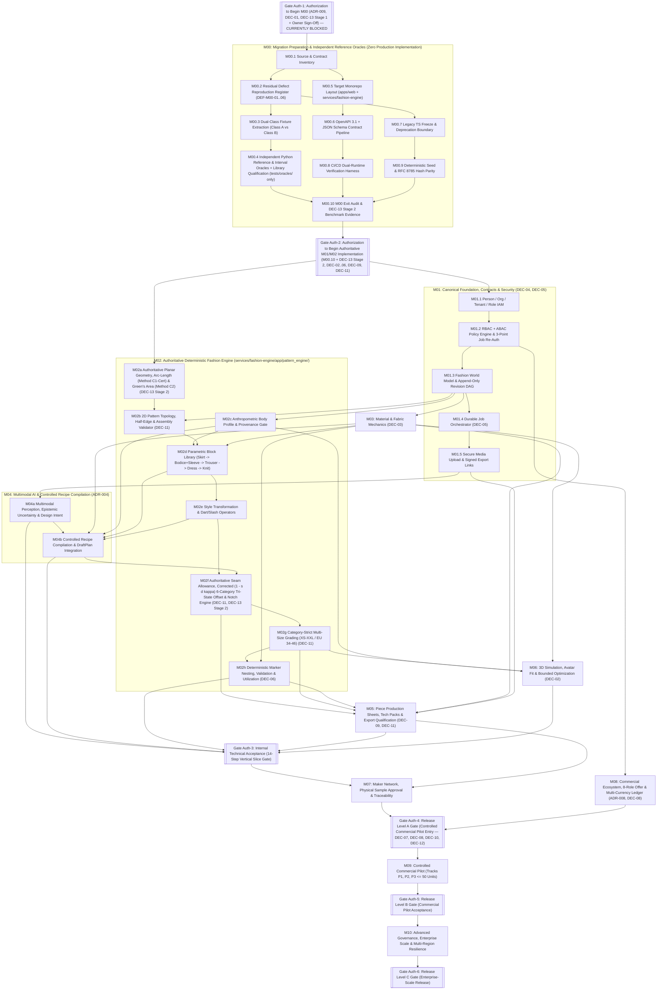

# 05 — WORKLOAD DEPENDENCY GRAPH (`R2.1.2`)

**Document ID:** `PATRONER-BP-R2.1.2-05`  
**Base Commit:** `8805140b1e6e7799922348369d7e29881102a75e` (`Patroner Blueprint R2.1.1`)  
**Status:** Authoritative Workload Sequencing, Strict `M00`/`M02` Scope Separation, `DEC-13` Circularity Resolution (`Critical Correction D`) & Gate Authority Consistency (`Critical Correction E`)  
**Governing Baseline:** `Patroner_Living_Project_Monograph_v5.16_Consolidated_Master.pdf` (`Ch. 14`, `Ch. 15`, `App. F`), `07_RISK_AND_OPEN_DECISIONS_REGISTER.md` (`R2.1.2`)

> **Governance Invariant:** **R2.1.2 publication does not authorize M00. M00 remains blocked pending explicit owner approval.**

---

## 1. Governing Sequencing Principles (`R2.1.2` Corrected)

1. **Strict Separation of `M00` (Migration Preparation & Independent Reference Oracles) vs. `M02` (Authoritative Production Implementation):**
   - **`M00` (`M00.1`–`M00.10`)** is strictly limited to source/contract inventory, defect reproduction (`DEF-M00-01`–`06`), legacy TS classification & freeze, Class A vs. Class B fixture extraction, canonical serialization baseline, and the **independent reference-oracle verification harness (`M00.4` in `services/fashion-engine/tests/oracles/`)** including the 8-point `IntervalLibraryQualificationReport` (`ADR-009 §3.4`). `M00` does **not** implement authoritative production geometry or production seam-offset algorithms.
   - **`M02` (`M02a`–`M02h` in `services/fashion-engine/app/pattern_engine/`)** owns all authoritative production geometry (`M02a`) and production seam-allowance offset, trimming, and validation (`M02f`).
2. **Resolution of `DEC-13` Circularity (`Critical Correction D`) & Gate Authority Consistency with Decision Register (`Critical Correction E`):**
   - Every gate assignment in this document is synchronized 100% with the authoritative source of truth in [`07_RISK_AND_OPEN_DECISIONS_REGISTER.md`](./07_RISK_AND_OPEN_DECISIONS_REGISTER.md):
   - **`Gate Auth-1` (Authorization to Begin `M00`):** Requires formal approval of **`ADR-009` (`R2.1.2`)**, **`DEC-01`** (Frontend Cutover & Monorepo Strategy), **`DEC-13 Stage 1`** (Initial Reference-Oracle Library Selection for `M00.4` based on static specification review — zero `M00.4` benchmark execution required prior to `Gate Auth-1`), and **explicit Project-Owner commencement authorization (`AUTH-M00-START`)**. **Current Status: `BLOCKED / UNAUTHORIZED`.** *(Note: `DEC-02` and `DEC-03` do NOT block `Gate Auth-1`; they belong to `Gate Auth-2`/`Gate Auth-3`.)*
   - **`Gate Auth-2` (Authorization to Begin `M01`/`M02` Authoritative Implementation):** Requires `M00.10` exit audit sign-off and the workload-specific engineering decisions assigned in `07_RISK_AND_OPEN_DECISIONS_REGISTER.md`:
     - **`DEC-13 Stage 2`** (`IntervalLibraryQualificationReport` + `< 5 ms` per-piece runtime latency benchmark across the 63 reference contours produced in `M00.4`) for **`M02a` / `M02f`**,
     - **`DEC-04`** (PostgreSQL 16 + S3/GCS primary store) for **`M01` (`M01.1`–`M01.3`)**,
     - **`DEC-05`** (Durable job queue & state machine) for **`M01.4`**,
     - **`DEC-11`** (Two-tier seam tolerance: `0.05 cm` CAD / `0.20 cm` sewn) before **`M02b` / `M02f` / `M02g` / `M05`** exit,
     - **`DEC-06`** (In-house buffered NFP marker solver) for **`M02h`**,
     - **`DEC-03`** (Material testing hardware & 3-tier provenance policy) before **`M03.1`** exit,
     - **`DEC-09`** (RFC 8785 SHA-256 + Ed25519 release signing) for **`M05.5`**,
     - **`DEC-02`** (3D orthotropic FEM + IPC simulation solver kernel) for **`M06.2`**.
   - Commercial, PSP, and tax/jurisdictional decisions (**`ADR-008 Schema`**, **`DEC-07`**, **`DEC-08`**, **`DEC-10`**, **`DEC-12`**) gate **`Gate Auth-4` (`Release Level A` — `M08` Completion & `M09` Pilot Entry)** and do **not** block `M00`–`M07`.
3. **Security and Domain Authority Before Computation (`M01`):** No production computational engine, AI workflow, or manufacturing export may run outside the `M01` tenant-isolated, RBAC+ABAC-authorized, append-only revision graph (`REQ-SEC-01`, `REQ-SEC-02`, `REQ-WM-02`).
4. **Separation of `M04a` (Perception & Intent) from `M04b` (Recipe Compilation) (`ADR-004`):**
   - **`M04a` (Multimodal Perception & Design Intent)** depends **only** on `M01` (`M01.3` World Model & `M01.4`/`M01.5` Secure Media Intake).
   - **`M04b` (Controlled Recipe Compilation & Engine Integration)** depends on `M04a`, `M02c`, `M02d`, `M02e`, and `M03`.
5. **Integration of `M02h` (Marker Nesting) into the Vertical Slice & `M05`:**
   - `M02h` depends on `M02g` and `M03`, and is a **hard prerequisite** for `M05` and **`Gate Auth-3` (`Vertical Slice Step 12`)**.
6. **Non-Circular Release Governance Between `M09` and `M10`:**
   - `M09` enters at **`Gate Auth-4` (`Release Level A`)** and exits at **`Gate Auth-5` (`Release Level B`)**. `M10` enters after `Gate Auth-5` and governs **`Gate Auth-6` (`Release Level C`)**.

---

## 2. Master Dependency & Authorization Gate Graph (Mermaid — `R2.1.2`)

---

## 3. Workload Prerequisite, Concurrency & Authorization Gate Matrix (`R2.1.2` — Synchronized with `07_RISK_AND_OPEN_DECISIONS_REGISTER.md`)

| Workload / Sub-Workload | Hard Technical Prerequisites | Required Governance Gate & Decisions (`07_RISK_AND_OPEN_DECISIONS_REGISTER.md`) | Parallelizable With | Unlocks | Primary Acceptance Gates | Release Governance Stage |
| :--- | :--- | :--- | :--- | :--- | :--- | :---: |
| **`M00` Migration Prep & Reference Oracles** | Base commit `e9d99cb4` (code) / `8805140b` (`plan/`) | **`Gate Auth-1`** (`ADR-009`, `DEC-01`, `DEC-13 Stage 1` + Explicit Project-Owner Authorization — **currently `BLOCKED`**) | None — foundation freeze | `Gate Auth-2` → `M01`, `M02a` | `AC-01`, `AC-02`, `AC-03`, `AC-04` | Pre-Level A (`Gate Auth-1`) |
| **`M01` Foundation & Security** | `M00.10` | **`Gate Auth-2`** (`M00.10` exit + **`DEC-04`** for `M01.1`–`M01.3` DB store + **`DEC-05`** for `M01.4` job orchestrator) | `M02a` (pure geometry kernel) | `M02b`–`M02h`, `M03`, `M04a`, `M05`, `M08` | `AC-01`, `AC-02`, `AC-04`, `AC-11` | `Gate Auth-2` → `Auth-3` |
| **`M04a` Multimodal Perception & Intent** | `M01.3`, `M01.5` | **`Gate Auth-2`** (`ADR-004` approved; zero `DEC-*` blocker beyond `M01` prerequisites) | `M02a`–`M02e`, `M03` | `M04b`, `Vertical Slice (Steps 02–03)` | `AC-01`, `AC-02`, `AC-04`, `AC-11` | `Gate Auth-2` → `Auth-3` |
| **`M02a` Authoritative Geometry Kernel** | `M00.4` (oracle harness & library qualification), `M00.10` | **`Gate Auth-2`** (`ADR-003`, `ADR-009` + **`DEC-13 Stage 2`** qualification report & `< 5 ms` benchmark from `M00.4`) | `M01`, `M02c`, `M04a` | `M02b`, `M02f`, `M05` | `AC-01`, `AC-02`, `AC-03` | `Gate Auth-2` → `Auth-3` |
| **`M02b` Pattern Topology & Assembly** | `M01.3`, `M02a` | **`Gate Auth-2`** (**`DEC-11`** required before `M02b`/`M02f`/`M02g` exit) | `M02c`, `M03`, `M04a` | `M02d`, `M02e`, `M02f` | `AC-02`, `AC-03`, `AC-05` | `Gate Auth-2` → `Auth-3` |
| **`M02c` Anthropometric Body Profile** | `M01.3` | **`Gate Auth-2`** (`M01.3` ready; feeds `DEC-07` pilot evaluation at `Gate Auth-4`) | `M02a`, `M02b`, `M03`, `M04a` | `M02d`, `M04b`, `M06` | `AC-02`, `AC-05` | `Gate Auth-2` → `Auth-3` |
| **`M03` Material & Fabric Mechanics** | `M01.3` | **`Gate Auth-2`** (**`DEC-03`** required before `M03.1` exit; correlation study at `Gate Auth-3`) | `M02a`–`M02c`, `M04a` | `M02d`, `M04b`, `M02h`, `M05`, `M06` | `AC-04`, `AC-07` | `Gate Auth-2` → `Auth-3` |
| **`M02d` Parametric Block Library** | `M02b`, `M02c`, `M03` (ease policies) | **`Gate Auth-2`** (`ADR-003`, `ADR-005`) | `M04a` | `M02e`, `M04b`, `M02f`, `M02g` | `AC-03`, `AC-05` | `Gate Auth-2` → `Auth-3` |
| **`M02e` Style Transformation Operators** | `M02d` | **`Gate Auth-2`** (`ADR-003`) | `M04a` | `M04b`, `M02f` | `AC-03`, `AC-05` | `Gate Auth-2` → `Auth-3` |
| **`M04b` Controlled Recipe Compilation** | `M04a`, `M02c`, `M02d`, `M02e`, `M03` | **`Gate Auth-2`** (`ADR-004` approved) | `M06.1`–`M06.3` (solver prep) | `M02f` (compiled `DraftPlan` execution), `Vertical Slice (Step 06)` | `AC-02`, `AC-04`, `AC-05` | `Gate Auth-2` → `Auth-3` |
| **`M02f` Authoritative Seam, Offset & Notch** | `M02a`, `M02b`, `M02d`, `M02e`, `M04b` | **`Gate Auth-2`** (`ADR-009`, **`DEC-13 Stage 2`**, **`DEC-11`**) | `M06.1`–`M06.3` | `M02g`, `M05` | `AC-03`, `AC-05`, `AC-10` | `Gate Auth-2` → `Auth-3` |
| **`M02g` Multi-Size Grading** | `M02f` | **`Gate Auth-2`** (**`DEC-11`**) | `M06` (base-size drape) | `M02h`, `M05`, `M06` (graded verification) | `AC-03`, `AC-06` | `Gate Auth-2` → `Auth-3` |
| **`M02h` Marker Nesting & Validation** | `M02g`, `M03` (fabric width/nap/shrinkage) | **`Gate Auth-2`** (**`DEC-06`** required at `M02h` entry; $\ge 78\%$ utilization benchmark at `Gate Auth-3`) | `M06` | `M05` (BOM consumption & marker artifacts), `Vertical Slice (Step 12)` | `AC-03`, `AC-05`, `AC-10` | `Gate Auth-2` → `Auth-3` |
| **`M05` Production Sheets & Tech Packs** | `M01.5`, `M02f`, `M02g`, `M02h`, `M03` | **`Gate Auth-2`** (`ADR-009`, **`DEC-11`**, **`DEC-09`** required at `M05.5` release-signing entry) | `M06`, `M08` | `Gate Auth-3` (`Vertical Slice Steps 12–14`), `M07` | `AC-03`, `AC-06`, `AC-10`, `AC-11` | `Gate Auth-3` |
| **`M06` 3D Simulation, Fit & Optimization** | `M02c`, `M02g`, `M03` | **`Gate Auth-2`** (**`DEC-02`** required before `M06.2` solver build; B1–B4 benchmarks at `Gate Auth-3`) | `M02h`, `M05`, `M08` | `Gate Auth-3` (`Vertical Slice Steps 08–10`), `M07` | `AC-07`, `AC-08`, `AC-09` | `Gate Auth-3` |
| **`M07` Maker Network & Traceability** | `M05`, `Gate Auth-3` (`Vertical Slice`) | **`Gate Auth-3`** (`DEC-09` signed release packages, `DEC-11` physical POM tolerances) | `M08` | `Gate Auth-4` (`Release Level A Gate`) → `M09` | `AC-09`, `AC-10`, `AC-11` | `Gate Auth-4` (`Level A`) |
| **`M08` Commerce & Multi-Currency Ledger** | `M01.2`, `M01.3` | **`Gate Auth-4`** (**`ADR-008 Schema`**, **`DEC-07`**, **`DEC-08`**, **`DEC-10`**, **`DEC-12`** required before `M08` completion / `M09` entry) | `M02`–`M07` | `Gate Auth-4` (`Release Level A Gate`) → `M09` | `AC-04`, `AC-11`, `AC-12` | `Gate Auth-4` (`Level A`) |
| **`M09` Controlled Commercial Pilot** | `Gate Auth-4` (`Release Level A Gate`: `Vertical Slice` + `M07` + `M08`) | **`Gate Auth-4`** (Entry: `DEC-07`, `DEC-08`, `DEC-10`, `DEC-12`, `ADR-008`) / **`Gate Auth-5`** (Exit) | None — live pilot execution | `Gate Auth-5` (`Release Level B Gate`) → `M10` | `AC-01`–`AC-12` (Level B Real Evidence) | Enters `Auth-4` (`Level A`) / Exits `Auth-5` (`Level B`) |
| **`M10` Advanced Governance & Scale** | `Gate Auth-5` (`Release Level B Gate` — `M09` Exit) | **`Gate Auth-5`** (Entry) / **`Gate Auth-6`** (Exit) | Post-pilot track expansion | `Gate Auth-6` (`Release Level C` Enterprise Operations) | `AC-04`, `AC-11`, `AC-12` (Level C) | `Gate Auth-6` (`Level C`) |

---

## 4. Corrected Critical Path Analysis (`R2.1.2`)

### 4.1 Critical Path 1 — To Internal Technical Acceptance (`Gate Auth-3`: Vertical Slice Gate)
$$\texttt{Gate Auth-1 (Blocked: ADR-009, DEC-01, DEC-13 Stage 1)} \longrightarrow \texttt{M00 (Prep, Oracles \& Library Qualification)} \longrightarrow \texttt{Gate Auth-2 (DEC-13 Stage 2, DEC-02..06, DEC-09, DEC-11)} \longrightarrow \texttt{M01} \longrightarrow (\texttt{M04a} \parallel \texttt{M02a} \to \texttt{M02b} \parallel \texttt{M02c} \parallel \texttt{M03}) \longrightarrow \texttt{M02d} \longrightarrow \texttt{M02e} \longrightarrow \texttt{M04b} \longrightarrow \texttt{M02f} \longrightarrow (\texttt{M06} \parallel [\texttt{M02g} \to \texttt{M02h} \to \texttt{M05}]) \longrightarrow \texttt{Gate Auth-3 (Vertical Slice)}$$

### 4.2 Critical Path 2 — To Controlled Commercial Pilot (`Gate Auth-4` to `Gate Auth-5`) & Enterprise Scale (`Gate Auth-6`)
$$\texttt{Gate Auth-3 (Vertical Slice)} \longrightarrow \texttt{M07} + \texttt{M08} \longrightarrow \texttt{Gate Auth-4 (Release Level A: ADR-008, DEC-07, DEC-08, DEC-10, DEC-12)} \longrightarrow \texttt{M09 Commercial Pilot} \longrightarrow \texttt{Gate Auth-5 (Release Level B)} \longrightarrow \texttt{M10} \longrightarrow \texttt{Gate Auth-6 (Release Level C)}$$
