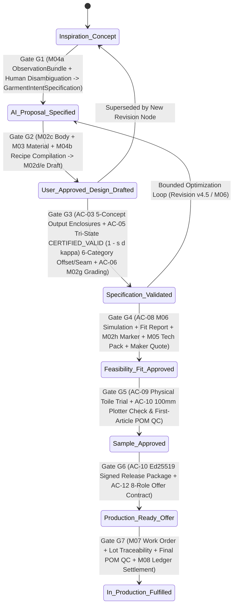

# 10 — RELEASE AND GOVERNANCE POLICY (`R2.1.2`)

**Document ID:** `PATRONER-BP-R2.1.2-10`  
**Base Commit:** `8805140b1e6e7799922348369d7e29881102a75e` (`Patroner Blueprint R2.1.1`)  
**Status:** Authoritative 8-State Realization Lifecycle, Six-Gate Authorization & Release Framework (`Gate Auth-1`–`Auth-6`), Tri-State Verification Promotion Rule, `isProductionReady` Gate & `Appendix F` Applicability Matrix  
**Governing Baseline:** `Patroner_Living_Project_Monograph_v5.16_Consolidated_Master.pdf` (`Ch. 09`, `Ch. 11`, `Ch. 17`, `Ch. 20`, `App. F`), `07_RISK_AND_OPEN_DECISIONS_REGISTER.md` (`R2.1.2`)

> **Governance Invariant:** **R2.1.2 publication does not authorize M00. M00 remains blocked pending explicit owner approval.**

---

## 1. The Canonical 8-State Realization Lifecycle (`v5.16 Ch. 09, p. 16`)

Every garment revision in the Fashion World Model (`M01`) is governed by an explicit, append-only 8-state realization lifecycle. To maintain 100% traceability between the strategic prose in `v5.16 Ch. 09 (p. 16)` and the technical state machine in `services/fashion-engine`, the table below maps each canonical `v5.16` realization state to its technical enum identifier, `isProductionReady` invariant, and required promotion gate:

| # | `v5.16 Ch. 09` Canonical State Name | Technical Enum (`lifecycle_state`) | `isProductionReady` Flag | Permitted Downstream Actions | Required Promotion Gate Evidence |
| :---: | :--- | :--- | :---: | :--- | :--- |
| **1** | **Inspiration** | `Concept` (`INSPIRATION_CONCEPT`) | `false` | Reference sketch/image upload, text brief intake (`M04a`) | Authenticated project & tenant context (`M01`). |
| **2** | **AI proposal** | `Specified` (`AI_PROPOSAL_SPECIFIED`) | `false` | Epistemic inspection, human disambiguation, measurement/material binding | `M04a` `DesignObservationBundle` + human disambiguation freezing `GarmentIntentSpecification`. |
| **3** | **User-approved design** | `Drafted` (`USER_APPROVED_DESIGN_DRAFTED`) | `false` | Seam allowance, miter, notch, and assembly validation (`M02b`/`M02f`) | Confirmed `GarmentIntentSpecification` (`M04a`) + `ValidatedBodyProfile` (`M02c`) + `CalibratedMaterialSpec` (`M03`) compiled via `M04b` into `M02d`/`M02e` 2D pieces. |
| **4** | **Specification in progress** | `Validated` (`SPECIFICATION_VALIDATED`) | `false` | 3D simulation (`M06`), multi-size grading (`M02g`), marker nesting (`M02h`), tech-pack compilation (`M05`) | Passing `AC-03` (5-concept output enclosures via 4-layer `Method C1-Cert` + qualified `mpmath.iv` & `Method C2`), `AC-05` (**tri-state `CERTIFIED_VALID`** complete-interval $t \in [0, 1]$ 6-category offset verification under $\mathbf{O}'(t) = (1 - s\,d\,\kappa(t))\mathbf{B}'(t)$ & seam mating), and `AC-06` (`M02g` multi-size grading). *(Note: If any interval check returns `INCONCLUSIVE`, revision enters `Verification_Pending` and cannot promote to `Validated` until escalated to `CERTIFIED_VALID` per `ADR-009`.)* |
| **5** | **Feasibility reviewed** | `Fit_Approved` (`FEASIBILITY_FIT_APPROVED`) | `false` | Sample cutting order & physical toile trial at qualified workshop (`M07`) | Passing `AC-08` (`M06` simulation convergence & `FitEvaluationReport`), `M02h` validated marker, `M05` `ManufacturingTechPack`, `M07.1` maker capability/quote match, and human patternmaker approval. |
| **6** | **Sample approved** | `Sample_Approved` (`SAMPLE_APPROVED`) | `false` | Cryptographic production release signing & commercial offer binding | Physical $100.0\text{ mm}$ plotter calibration check ($\pm 0.1\text{ mm}$) + physical first-article sample measured and approved against POM tolerances (`AC-09`, `AC-10`, `M07.2`). |
| **7** | **Production-ready offer** | `Production_Ready` (`PRODUCTION_READY_OFFER`) | **`true`** *(Revision-Scoped)* | Commercial checkout (`M08`/`M09`) & production work-order dispatch (`M07.4`) | RFC 8785 canonical JSON manifest + SHA-256 Merkle root + Ed25519 signature (`SignedManufacturingReleasePackage`, `DEC-09`) + 8-role `ProductOfferContract` (`AC-10`, `AC-11`, `AC-12`). |
| **8** | **In production / fulfilled** | `In_Production_Completed` (`IN_PRODUCTION_FULFILLED`) | **`true`** *(Locked)* | Shop-floor operation logging, final POM QC, shipment, financial settlement | Complete `WorkOrderOperationLog`, lot traceability, final POM inspection pass (`M07.5`), and balanced double-entry ledger settlement (`M08`). |

---

## 2. Hard Invariant on `isProductionReady: false` & Tri-State Fail-Closed Promotion Rule

1. **Global Default:** Across all software builds in `M00` through `M06`, `isProductionReady` **must remain `false`** by default on all pattern, grading, marker, and piece-production-sheet artifacts.
2. **Prohibition on Manual Override:** No UI toggle, query parameter, or client payload may set `isProductionReady: true`.
3. **Tri-State Verification Promotion Rule (`ADR-009`):**
   - Only `overall_status == "CERTIFIED_VALID"` permits promotion across `Gate G3` (`Validated`), `Gate G4` (`Fit_Approved`), `Gate G5` (`Sample_Approved`), or `Gate G6` (`Production_Ready`).
   - `CERTIFIED_INVALID` transitions the revision to `Invalid` with the exact proven failure category (`REGULARITY_MARGIN_VIOLATION`, `ACTUAL_ZERO_SPEED_CUSP`, `TANGENT_REVERSAL`, `LOCAL_OFFSET_SELF_INTERSECTION`, or `GLOBAL_CONTOUR_SELF_INTERSECTION`).
   - `INCONCLUSIVE` (`INCONCLUSIVE_VERIFICATION`) blocks promotion (`is_production_ready = False`) and transitions the revision to `Verification_Pending` for precision/degree/subdivision escalation, **without ever misreporting the uncertified interval as a confirmed geometric defect**.
4. **Cryptographic Promotion Function:** In `services/fashion-engine`, `is_production_ready` is a computed read-only property derived exclusively from the presence of a valid, non-revoked `SignedManufacturingReleasePackage` (`State 7`) linking a `Validated` (`CERTIFIED_VALID`) + `Fit_Approved` revision (`AC-03`, `AC-05`, `AC-06`, `AC-08`), a signed `PhysicalSampleApprovalRecord` (`AC-09`, `AC-10`), and a qualified `MakerOfRecord` capability match (`M07`).

---

## 3. Six-Stage Program Authorization & Release Governance Framework (`Synchronized with 07_RISK_AND_OPEN_DECISIONS_REGISTER.md`)

To govern both early engineering commencement (`M00`, `M01`/`M02`) and commercial/enterprise releases (`M09`, `M10`) without circularity or disproportionate blocking (`07_RISK_AND_OPEN_DECISIONS_REGISTER.md Section 3`), Patroner enforces six sequential program authorization gates:

| Gate ID | Gate Name | Required Decisions & Evidence (`07_RISK_AND_OPEN_DECISIONS_REGISTER.md`) | What It Authorizes | Current Status |
| :--- | :--- | :--- | :--- | :---: |
| **`Gate Auth-1`** | **Authorization to Begin `M00` (Migration Prep & Oracles)** | Formal human approval of **`ADR-009` (`R2.1.2`)**, **`DEC-01`**, **`DEC-13 Stage 1`** (initial reference-oracle library selection via specification review — zero `M00` execution required prior to `Gate Auth-1`) + **explicit Project-Owner authorization (`AUTH-M00-START`)**. | Execution of `M00.1`–`M00.10` (inventory, defect reproduction, legacy TS freeze, Class A/B fixtures, `M00.4` independent oracle harness & library qualification). | **`BLOCKED / UNAUTHORIZED`** |
| **`Gate Auth-2`** | **Authorization to Begin Authoritative `M01`/`M02` Implementation** | `M00.10` Exit Audit sign-off + **`DEC-13 Stage 2`** (`IntervalLibraryQualificationReport` + `< 5 ms` benchmark across 63 contours from `M00.4` for `M02a`/`M02f`) + workload-specific engineering decisions (**`DEC-04`**, **`DEC-05`** for `M01`; **`DEC-11`** for `M02b`/`M02f`/`M02g`/`M05`; **`DEC-06`** for `M02h`; **`DEC-03`** for `M03.1`; **`DEC-09`** for `M05.5`; **`DEC-02`** for `M06.2`). | Authoritative implementation of `M01`–`M06` in `services/fashion-engine` and `apps/web`. *(Not blocked by commercial/tax decisions `DEC-07`, `DEC-08`, `DEC-10`, `DEC-12`, `ADR-008 Schema`.)* | Pending `Gate Auth-1` & `M00.10` |
| **`Gate Auth-3`** | **Internal Technical Acceptance (`Vertical Slice Gate`)** | 100% pass of the 14-step Vertical Slice (`plan/08`) + closure of empirical evidence for `DEC-01`–`06`, `DEC-09`, `DEC-11`, `DEC-13 Stage 2`, `ADR-001`–`006`, `ADR-009`. | Entry into `M07` physical workshop qualification and first-article sample trials. | Pending `M01`–`M06` |
| **`Gate Auth-4`** | **Controlled Commercial Pilot Entry (`Release Level A Gate`)** | `Gate Auth-3` + `M07` ($\ge 2$ qualified workshops & approved physical samples) + `M08` multi-currency ledger + **`ADR-007`**, **`ADR-008`**, **`DEC-07`**, **`DEC-08`**, **`DEC-10`**, **`DEC-12`** (legal/tax CPA sign-off). | Launch of the capped `M09` Controlled Commercial Pilot ($\le 50$ units across Tracks P1, P2, P3). | Pending `Gate Auth-3`, `M07`, `M08` |
| **`Gate Auth-5`** | **Commercial Pilot Acceptance (`Release Level B Gate`)** | Empirical `M09` pilot completion ($\ge 95\%$ first-pass POM QC yield, bounded fit return rates, $0$ minor-unit cash-to-ledger reconciliation variance). | Closure of `M09` and entry into `M10` enterprise-scale expansion. | Pending `M09` Execution |
| **`Gate Auth-6`** | **Enterprise-Scale Release (`Release Level C Gate`)** | Completion of `M10` (`M10.1`–`M10.5`: repeatable Brand Studio waterfalls, BYOK KMS, automated crypto-shredding, partner APIs, multi-region DR drills). | Full institutional and multi-brand enterprise operations. | Pending `M10` Execution |

---

## 4. `v5.16 Appendix F` Applicability Matrix Across `Gate Auth-4` (`Level A`), `Gate Auth-5` (`Level B`), and `Gate Auth-6` (`Level C`)

All 10 institutional gates of `v5.16 Appendix F (p. 41)` are preserved in full and mapped to their exact release stage below:

| `v5.16 Appendix F` Gate | Institutional Requirement | **Level A (`Gate Auth-4`): Engineering & Controlled Pilot Entry (`M09` Entry)** | **Level B (`Gate Auth-5`): `M09` Pilot Exit Acceptance (Unlocks `M10`)** | **Level C (`Gate Auth-6`): Enterprise & Institutional Scale Release (`M10` Exit)** |
| :--- | :--- | :--- | :--- | :--- |
| **Gate F.1 — System-of-Systems Boundary Integrity** (`Addendum v4.1`) | Zero authoritative domain math, grading, marker, simulation, or approval execution in client UI; zero production implementation inside `M00` (`tests/oracles/`). | **MANDATORY (`AC-04`):** CI AST verification & bundle audit for Vertical Slice & pilot surfaces. | **MAINTAINED:** Zero boundary regressions during live pilot operations. | **MANDATORY:** Extended to enterprise white-label & partner API gateways (`M10.3`). |
| **Gate F.2 — Deterministic Numerical & Geometric Certification** | 5-concept validated output bounds (`Method C1-Cert` 4-layer assurance + qualified `mpmath.iv`, `Method C2`, `ADR-009`) & tri-state `CERTIFIED_VALID` complete-interval $[0, 1]$ 6-category offset verification under $\mathbf{O}'(t) = (1 - s\,d\,\kappa(t))\mathbf{B}'(t)$ (`Method C3`). | **MANDATORY (`AC-03`):** Validated `Method C1-Cert/C2/C3` enclosures verified across all pilot blocks (`skirt-block-v1`, `bodice-sleeve-v1`). | **MAINTAINED:** Verified across all pilot custom-fit (`Track P3`) customer revisions. | **MANDATORY:** Verified across all expanded garment families (`trouser`, `dress`, `knit`). |
| **Gate F.3 — Cross-Size Grading, Construction & Marker Certification** | Full size-matrix seam parity, anti-cloning, and `M02h` non-overlapping marker utilization. | **MANDATORY (`AC-05`, `AC-06`):** Verified across `XS`–`XXL` / `EU 34`–`46` for pilot capsules. | **MANDATORY (Real Evidence):** Zero marker/cut-fit geometric failures across $\le 50$ pilot garments. | **MANDATORY:** Automated across multi-brand grading libraries. |
| **Gate F.4 — Material Characterization & Shrinkage Compliance** | Separation of raw test observations from calibrated parameters; physical coupon evidence (`DEC-03`). | **MANDATORY (`AC-07`):** `TIER_1_LAB` or `TIER_2_BENCHTOP` certificates for all pilot capsule fabrics. | **MANDATORY (Real Evidence):** Incoming physical roll lot shrinkage (`M07.3`) vs. post-press POM drift reconciled. | **MANDATORY:** Multi-mill supplier lot federation & automated closed-loop calibration. |
| **Gate F.5 — Simulation Convergence & Physical Toile Concordance** | Analytical solver benchmarks B1–B4 (`DEC-02`) + physical vs. digital fit concordance (`DEC-07`). | **MANDATORY (`AC-08`, `AC-09`):** Solver passes B1–B4; physical toile trial passes $\le 0.5\text{ cm}$ POM concordance on pilot blocks. | **MANDATORY (Real Evidence):** Real customer fit return/remake rate $\le 8\%$ (P1/P2) and $\le 12\%$ (P3) (`AC-09`). | **MANDATORY:** Multi-pose & 3D body-scan cohort calibration across expanded categories. |
| **Gate F.6 — Manufacturing Tech-Pack, Plotter & Maker Qualification** | $100.0\text{ mm}$ physical plotter calibration, complete BOM/ISO 4915/4916/POM tech pack, and qualified makers. | **MANDATORY (`AC-10`):** Physical $100.0\text{ mm}$ check ($\pm 0.1\text{ mm}$), complete tech pack, and $\ge 2$ workshops qualified with approved physical samples. | **MANDATORY (Real Evidence):** $\ge 95\%$ first-pass final POM QC yield across all shipped pilot units (`M07.5`). | **MANDATORY:** Multi-region maker network SLA routing & automated capacity balancing. |
| **Gate F.7 — Multi-Tenant Security, RBAC+ABAC & Job Re-Authorization** | Person/Org/Tenant isolation, PostgreSQL RLS (`DEC-04`), 3-point worker re-auth (`DEC-05`), scoped workshop grants. | **MANDATORY (`AC-11`):** Zero-finding cross-tenant penetration test & mid-job revocation verification across Own-Label, Brand Studio, and Maker tenants. | **MAINTAINED:** Zero cross-tenant or workshop PII exposure incidents during pilot. | **MANDATORY:** Enterprise BYOK KMS envelope encryption & external security audit (`M10.2`). |
| **Gate F.8 — Cryptographic Provenance & Reproducibility Audit** | RFC 8785 Canonical JSON SHA-256 Merkle lineage + Ed25519 release signatures (`DEC-09`). | **MANDATORY (`AC-11`):** End-to-end replay reproducing identical digests from intent to `SignedManufacturingReleasePackage`. | **MANDATORY (Real Evidence):** 100% of shipped `GarmentSerialUnitID` units trace unbrokenly to signed release packages and fabric lots. | **MANDATORY:** Preserved under GDPR biometric crypto-shredding (`M10.2`). |
| **Gate F.9 — 8-Role Commercial Contract & Multi-Currency Double-Entry Ledger** | 8-role `ProductOfferContract`, ISO 4217 multi-currency balanced ledger (`ADR-008`, `DEC-08`), VAT/reserves (`DEC-12`), and 8 metrics. | **MANDATORY (`AC-12`):** 8-role contract enforcement, 5,000-lifecycle ledger property test, sandbox settlement dry run, and legal/tax sign-off (`DEC-12`). | **MANDATORY (Real Evidence):** $0$ minor-unit cash-to-ledger reconciliation variance across all real pilot orders, refunds, maker invoices, and creator payouts. | **MANDATORY:** Celebrity/licensed minimum-guarantee advance recoupment waterfalls (`M10.1`). |
| **Gate F.10 — Operational Resilience, Backup Restore & Privacy Governance** | Database/artifact backup restoration, incident rollback, and GDPR data retention/erasure. | **PILOT-SCOPED (`Level A`):** Single-region automated daily PostgreSQL + object-store backups with **verified pre-pilot restore test** (`RPO <= 1 hr`, `RTO <= 2 hr`) and documented GDPR erasure procedure (`M01`). | **MAINTAINED:** Zero unrecoverable data loss; timely processing of any pilot subject privacy requests. | **ENTERPRISE-SCOPED (`Level C` in `M10.2`/`M10.4`):** Multi-region active/standby automated DR drills (`RPO <= 5 min`, `RTO <= 30 min`) and automated crypto-shredding pipeline at scale. |

> **Non-Promotion Rule:** Passing **`Gate Auth-4` (`Level A`)** authorizes launching the capped `M09` Commercial Pilot ($\le 50$ units) — it must **never** be represented as **`Gate Auth-5` (`Level B`)** (proven commercial/manufacturing pilot acceptance) or **`Gate Auth-6` (`Level C`)** (enterprise production readiness).

---

## 5. Living Monograph & Blueprint Governance Protocol (`v5.16 Ch. 20`)

1. **No Silent Architecture Drift:** Any proposed change to system boundaries, mathematical tolerances, lifecycle states, or commercial roles requires a formal **ADR (`decisions/ADR-00X`)**, an update to `01_SOURCE_REGISTER_AND_REQUIREMENTS.md`, and explicit human approval.
2. **Evidence Classification Preservation:** Every capability reported in status updates or release notes must carry its true implementation classification (`I1`, `I2`, `P`, `D`, `M`, `X`, `R`, `H`) verified by independent tests rather than commit messages.
3. **No Implied Authorization:** **R2.1.2 publication does not authorize M00. M00 remains blocked pending explicit owner approval.**
