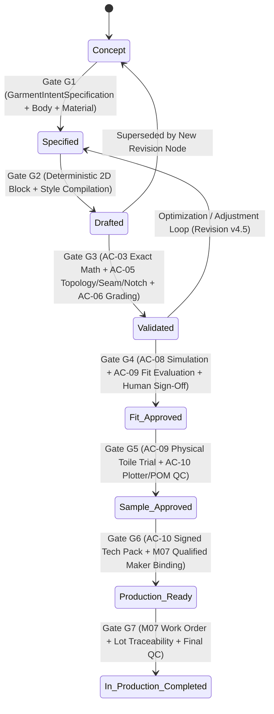

# 10 — RELEASE AND GOVERNANCE POLICY

**Document ID:** `PATRONER-BP-R2-10`  
**Status:** Authoritative Release Lifecycle, `isProductionReady` Gate & Living Monograph Governance Policy  
**Governing Baseline:** `Patroner_Living_Project_Monograph_v5.16_Consolidated_Master.pdf` (`Ch. 09`, `Ch. 11`, `Ch. 17`, `Ch. 20`, `App. F`)

---

## 1. The Canonical 8-State Realization Lifecycle (`v5.16 Ch. 09`)

Every garment revision in the Fashion World Model (`M01`) is governed by an explicit, append-only 8-state machine. No state may be skipped, and every forward transition requires a cryptographically verifiable evidence bundle:

| State | `isProductionReady` Flag | Permitted Downstream Actions | Required Promotion Gate Evidence |
| :--- | :---: | :--- | :--- |
| **1. `Concept`** | `false` | Multimodal intake, sketch upload, ambiguity prompts | Authenticated project & tenant context (`M01`). |
| **2. `Specified`** | `false` | Deterministic recipe compilation & 2D drafting | Confirmed `GarmentIntentSpecification` (`M04`), `ValidatedBodyProfile` (`M02c`), and `CalibratedMaterialSpec` (`M03`). |
| **3. `Drafted`** | `false` | Seam allowance, miter, notch, and assembly validation | Complete 2D planar pieces in `float64` with provenance digest (`M02d`/`M02e`). |
| **4. `Validated`** | `false` | 3D simulation, grading, digital diagnostic preview | Passing `AC-03` (math bounds), `AC-05` (seam mating $\le 0.05\text{ cm}$, closed contours), and `AC-06` (cross-size grading). |
| **5. `Fit_Approved`** | `false` | Sample tech-pack generation & sample cutting order | Passing `AC-08` (simulation convergence), `FitEvaluationReport`, and human patternmaker approval (`M06`). |
| **6. `Sample_Approved`** | `false` | Final production release package signing | Physical toile/first-article sample measured and approved against POM tolerances (`AC-09`, `AC-10`, `M07`). |
| **7. `Production_Ready`** | **`true`** *(Revision-Scoped)* | Commercial checkout binding (`M08`) & production cutting (`M07`) | RFC 8785 canonical JSON manifest + SHA-256 Merkle root + Ed25519 QA/Patternmaker signature (`M05` + `M07`). |
| **8. `In_Production_Completed`** | **`true`** *(Locked)* | Shop-floor operation logging, final QC, shipment, financial settlement | Complete `WorkOrderOperationLog`, lot traceability, and final inspection pass (`M07`, `M08`). |

---

## 2. Hard Invariant on `isProductionReady: false`

1. **Global Default:** Across all software builds in `M00` through `M06`, `isProductionReady` **must remain `false`** by default on all pattern, grading, and piece-production-sheet artifacts.
2. **Prohibition on Manual Override:** No UI toggle, query parameter, or client payload may set `isProductionReady: true`.
3. **Cryptographic Promotion Function:** In `services/fashion-engine`, the field `is_production_ready` is a computed read-only property derived exclusively from the presence of a valid, non-revoked `SignedManufacturingReleasePackage` that links:
   - A `Validated` + `Fit_Approved` pattern revision digest (`AC-03`, `AC-05`, `AC-06`, `AC-08`),
   - A `PhysicalSampleApprovalRecord` signed by an authorized QA role (`AC-09`, `AC-10`), and
   - A qualified `MakerOfRecord` capability match (`M07`).

---

## 3. Master Release Checklist (`v5.16 Appendix F` — 10 Institutional Gates)

No platform release or commercial capsule may be promoted to production without passing all **10 Appendix F Institutional Gates**:

| Gate | Institutional Requirement | Verifying Artifact |
| :--- | :--- | :--- |
| **Gate F.1** | **System-of-Systems Boundary Integrity** (`Addendum v4.1`) | CI AST verification report proving zero authoritative math/domain execution in `apps/web` (`AC-04`). |
| **Gate F.2** | **Deterministic Numerical & Geometric Certification** | Independent Python `mpmath` verification report across all active blocks, offsets, and contours (`AC-03`). |
| **Gate F.3** | **Cross-Size Grading & Construction Certification** | Full size-matrix seam-mating, notch, and monotonic scaling report (`AC-05`, `AC-06`). |
| **Gate F.4** | **Material Characterization & Shrinkage Compliance** | Tier 1/2 fabric test certificate & shrinkage compensation verification (`AC-07`). |
| **Gate F.5** | **Simulation Convergence & Physical Toile Concordance** | Analytical solver benchmark report + physical vs. digital fit trial concordance report (`AC-08`, `AC-09`). |
| **Gate F.6** | **Manufacturing Tech-Pack & 1:1 Plotter Qualification** | Physical $100.0\text{ mm}$ calibration square verification + complete BOM/ISO 4915/4916/POM package (`AC-10`). |
| **Gate F.7** | **Multi-Tenant Security, RBAC+ABAC & Job Re-Authorization** | Zero-finding cross-tenant penetration test & worker mid-job revocation report (`AC-11`). |
| **Gate F.8** | **Cryptographic Provenance & Reproducibility Audit** | End-to-end replay test reproducing identical SHA-256 digests from seed + revision inputs (`AC-11`). |
| **Gate F.9** | **8-Role Commercial Contract & Double-Entry Ledger Audit** | Balanced trial balance, VAT/reserve verification, and creator/maker settlement dry run (`AC-12`). |
| **Gate F.10** | **Operational Resilience, Backup Restore & Retention Compliance** | Verified point-in-time PostgreSQL + object-store restore drill and GDPR body-scan deletion audit (`M10`). |

---

## 4. Living Monograph & Blueprint Governance Protocol (`v5.16 Ch. 20`)

Per `v5.16 Chapter 20 (Living Document Governance)`:
1. **No Silent Architecture Drift:** Any proposed change to system boundaries, mathematical tolerances, lifecycle states, or commercial roles requires:
   - A formal **Architecture Decision Record (`ADR-00X`)** under `/plan/decisions/`,
   - An update to the affected requirement (`REQ-*`) in `/plan/01_SOURCE_REGISTER_AND_REQUIREMENTS.md`, and
   - Explicit reconciliation against `Patroner_Living_Project_Monograph_v5.16_Consolidated_Master.pdf`.
2. **Evidence Classification Preservation:** Every capability reported in status updates or release notes must carry its true implementation classification (`I1` Production-Grade, `I2` Partial, `P` Prototype, `D` Demo/Mock, `M` Missing) verified by independent tests rather than self-reported commit messages.
